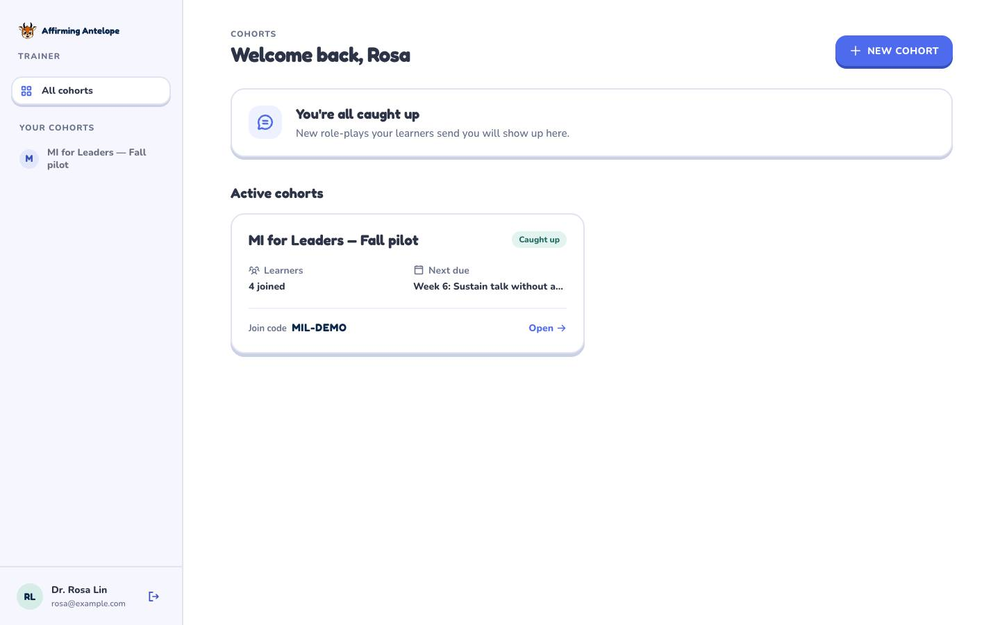
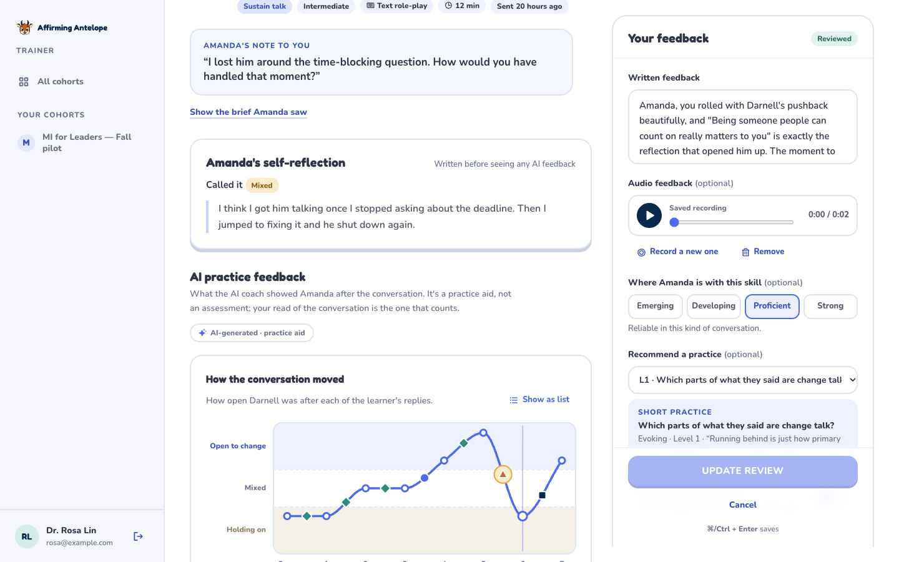
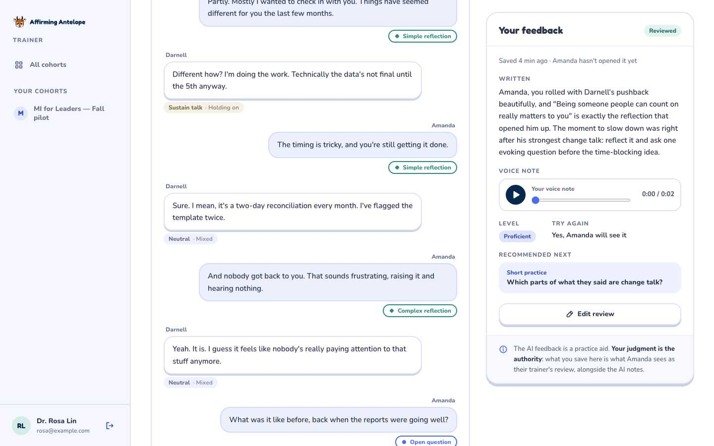

# Trainer dashboard

The web side of Affirming Antelope for MI trainers: create cohorts, assign practice from
the MI for Leaders library, and review the role-plays learners choose to submit. It lives
in `apps/web` under `/trainer`. The landing page links to it from the footer ("For trainers").

Everything runs as the signed-in trainer through Supabase RLS. The web app never uses the
service-role key. The database contract is `docs/data-model.md`.



## Routes

| Route | What it is |
|---|---|
| `/trainer/sign-in` | Email, then a 6-digit code (`signInWithOtp` / `verifyOtp` type `email`). New emails get an account. `?next=` returns you where you were. |
| `/trainer/become` | Signed in without `can_train`: enter your name and a trainer code (`claim_trainer`). |
| `/trainer` | Cohorts home: an attention summary ("1 submission needs review", with a link to the oldest), cohort cards, archived cohorts, and **New cohort** (`create_cohort`), which shows the join code big with copy and rotate. |
| `/trainer/cohorts/[id]` | **Participants**: invite panel with the join code (copy, rotate via `rotate_join_code`), then a sortable table built from `cohort_member_stats` (Participant, Assigned, Completed, Needs review, Last active). It has an empty state that explains how learners join. |
| `/trainer/cohorts/[id]/assignments` | Open assignments with their items and per-learner progress (`assignment_progress`). Archive an assignment inline. |
| `/trainer/cohorts/[id]/assignments/new` | The composer: title, instructions, a due date (5pm local), and items picked from `@antelope/core`: N drills on a skill (`any-drill`), a specific drill, a role-play scenario (with its brief, goal and difficulty), or a pathway lesson. A live preview shows what learners see ("2 short practices + 1 AI role-play · Due Friday"). |
| `/trainer/cohorts/[id]/reviews` | The review queue. Filter by Needs review, Reviewed or All, and sort oldest or newest first (`?status=&sort=`). |
| `/trainer/submissions/[id]` | The review page (below). |

Signed-out visits to any `/trainer` page redirect to sign-in. Signed-in users without
`can_train` are sent to `/trainer/become`. A cohort or submission the viewer doesn't train
returns 404.

## The review page



- **Header**: the learner, the scenario title, persona and context, skill, difficulty, mode, duration and when it was sent. The learner's note sits in a quote, and the brief they saw is one click away.
- **Self-reflection**: how the learner said it went, written before they saw any AI feedback.
- **AI practice feedback**, labelled as a practice aid:
  - The trajectory chart uses the same zones and curve as mobile ("Holding on / Mixed / Open to change", monotone cubic, move markers shaped by family, key moments ringed in ochre). It draws in when scrolled into view. Hover, focus or arrow-key along it for each exchange, or switch it to a list.
  - Move tallies, the strengths the coach named, "Try next", and key moments with "One possible MI-consistent response" options and the reason behind them.
- **Transcript** with observer tags inline: move tags on learner turns, change or sustain talk (plus stance) on employee turns. Hover or focus a tag to read the observer's note. Key moments link back and forth between the transcript and their cards.
- **Feedback panel**, sticky on wide screens (a jump button below `xl`):
  - written feedback
  - an audio note recorded in the browser with MediaRecorder (record, pause and resume, stop, play back, re-record, discard; up to 5 minutes, with a live level meter)
  - a level (Emerging, Developing, Proficient, Strong), shown as words and never as a number
  - a practice recommendation from the core library
  - a "Try again" switch
  - Save (or ⌘/Ctrl+Enter)

  Saving uploads the clip to `review-audio/{cohort_id}/{submission_id}/{uuid}.webm|m4a` from the browser, then a Server Action inserts or updates the one review for the submission. The database trigger flips the submission to `reviewed`. Editing reopens the same form. A replaced or removed clip is deleted from Storage. A note under the panel says the AI feedback is a practice aid and the trainer's judgment is the authority.



## How it's built (Next 16)

- `src/proxy.ts`: Next 16 renamed Middleware to **Proxy** (`proxy.ts`, `export function proxy`, Node runtime). It matches `/trainer` and `/trainer/:path*` only, refreshes the Supabase session cookie with `@supabase/ssr`, and redirects signed-out visitors. It's an optimistic check only.
- `src/lib/supabase/`: `client.ts` (`createBrowserClient`), `server.ts` (`createServerClient` over the async `cookies()`), and `proxy.ts` (`updateSession`, which mirrors refreshed cookies and cache headers onto the response). `env.ts` reads the two public env vars.
- `src/lib/trainer/dal.ts`: the data access layer. `getViewer()` verifies the JWT with `auth.getClaims()` and is memoized per request with React `cache`. `requireUser`, `requireTrainer` and `requireTrainedCohort` run in every page and layout, because layouts don't re-render on client navigation.
- `src/app/trainer/actions.ts`: Server Actions for sign-out, `claimTrainer`, `createCohort`, `rotateJoinCode`, `setCohortArchived`, `createAssignment`, `archiveAssignment` and `saveReview`. Each one re-checks the session and validates its input against core content, and they return UI-shaped results rather than rows. `createCohort` and `rotateJoinCode` deliberately skip `revalidatePath`, because re-rendering would unmount the dialog that shows the new code. The client refreshes when the dialog closes.
- Pages use `PageProps<'/route'>` and `LayoutProps<'/route'>` with awaited `params` and `searchParams`.
- `src/lib/trainer/content.ts` holds the shared labels (moves, families, zones, ratings) that mirror `apps/mobile/src/components/practice-loop/moves.ts`, plus catalog lookups and date helpers. `exchanges.ts` mirrors mobile's `buildExchanges`.
- UI lives in `src/components/trainer/**`. It uses the brand tokens from `globals.css` (cobalt primary with the 3D bottom shadow, ochre only for attention and achievement, Fredoka display and Nunito UI) and Motion for tabs, dialogs, lists, the chart, saving and the recorder. Every animation checks `useReducedMotion`. Dialogs are native `<dialog>` elements, so focus is trapped and Esc closes them.

## AI API auth

The three AI routes (`/api/roleplay/turn`, `/api/roleplay/debrief`, `/api/drill/feedback`)
call `authorize()` from `src/lib/ai/auth.ts`:

- `Authorization: Bearer <supabase access token>` is verified with `supabase.auth.getClaims(token)`, which checks it against the project JWKS, with no session stored. Each user is rate limited (`{bucket}:user:{id}`, same per-minute limits as guests). A malformed, expired or forged token gets `401 {"error":"invalid_token"}`; it never falls back to guest.
- Otherwise the request is a guest: the `x-antelope-key` app token is required when `APP_CLIENT_TOKEN` is set (`401 {"error":"unauthorized"}`), and guests are limited per IP. With `APP_CLIENT_TOKEN` unset (local dev), guests stay allowed.
- CORS now allows the `Authorization` header. Mock mode (`AI_MOCK`) is unchanged.

## Env

| Var | Where | Notes |
|---|---|---|
| `NEXT_PUBLIC_SUPABASE_URL` | web | Local: `http://127.0.0.1:54321` |
| `NEXT_PUBLIC_SUPABASE_PUBLISHABLE_KEY` | web | Local: the publishable key from `supabase status` (a public default). Safe in the browser. |
| `APP_CLIENT_TOKEN`, `ANTHROPIC_API_KEY`, `AI_MOCK`, … | web | Unchanged; see `.env.example`. |

## Run it locally

```sh
npm run db:start            # Supabase (Docker); Mailpit at http://127.0.0.1:54324
npm run dev -w web          # http://localhost:3000/trainer
```

Sign in as `rosa@example.com` and read the code in Mailpit. To try the new-trainer flow,
sign in with any new email and use trainer code `TRAIN-PILOT`.
